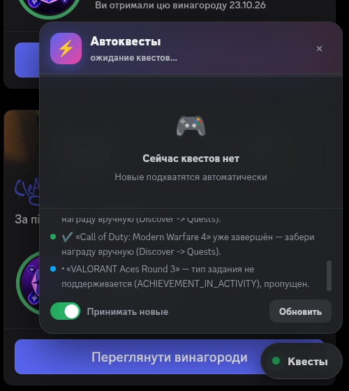

# ⚡ Discord Quest Auto-Runner

**Auto-completes Discord quests** — video quests, "play a game for 15 minutes", "stream for 15 minutes", activity quests — without installing any game. Comes with a floating glass-morphism panel that appears on the Quests tab.



> ⚠️ **Disclaimer:** automation violates the [Discord Terms of Service](https://discord.com/terms). Use at your own risk, for educational purposes.

## What it does

| Quest type | Works? | How |
|---|---|---|
| Watch video (`WATCH_VIDEO`, `..._ON_MOBILE`) | ✅ | fast-forwards timestamps via `/video-progress` |
| Play a game N minutes (`PLAY_ON_DESKTOP`, `_V2`) | ✅ | periodic `heartbeat` with a `stream_key` |
| Stream N minutes (`STREAM_ON_DESKTOP`) | ✅ | same heartbeat (+ store patch on desktop) |
| Be in an activity N minutes (`PLAY_ACTIVITY`) | ✅ | same heartbeat |
| Unlock an achievement in a game (`ACHIEVEMENT_IN_ACTIVITY`) | ❌ | server rejects it (403) — only manually |

- Quests run **in parallel** and in the background — a 15-minute quest really takes ~15 minutes (the server credits real wall-clock time between heartbeats), but all quests of this kind run at the same time.
- New quests appearing on your account are **picked up automatically** every 20 s.
- Rewards are claimed by pressing the button on the quest card (auto-claim is off by default).

## Quick start (manual, works everywhere)

1. Open **Discord** (desktop app or browser), go to **Discover → Quests**
2. Press **Ctrl+Shift+I** → **Console** tab
3. If pasting is blocked, type `allow pasting` and press Enter
4. Paste the whole script and press Enter:
   - [`quests-en.js`](quests-en.js) — English
   - [`quests-ru.js`](quests-ru.js) — русский

That's it. Stop with `__questsStop()`, status with `__questsStatus()`.

## Auto-install

### Linux (Arch-based, e.g. Omarchy) — one command

```bash
curl -fsSL https://raw.githubusercontent.com/doctorsalamii/discord-quest-auto-runner/main/install-linux.sh | bash
```

What it does:
- installs the Discord desktop client (`pacman -S discord`) if missing
- enables DevTools in `~/.config/discord/settings.json`
- installs a **supervisor** (systemd user service) that injects the script into every running Discord automatically
- patches the `Discord.desktop` entry so the client starts with a debug port

After that: just open Discord normally. Quests complete themselves. Rewards are claimed by hand on the quest cards.

> ⏳ **Be patient after opening Discord:** the panel appears within **1–2 minutes**. The supervisor scans every 30 s, and if Discord restarted itself without the debug port, it first waits out a 2-minute cooldown before relaunching it. Everything self-heals — see [Self-healing notes](#self-healing-notes).

Manual alternative:

```bash
git clone https://github.com/doctorsalamii/discord-quest-auto-runner.git
cd YOUR_REPO
./install-linux.sh
```

### Windows — one command

```powershell
powershell -c "irm https://raw.githubusercontent.com/doctorsalamii/discord-quest-auto-runner/main/install-windows.ps1 | iex"
```

What it does:

- checks Node.js LTS and the Discord client
- installs `quests.js` + `inject.mjs` + helper scripts to `%LOCALAPPDATA%\discord-quests`
- registers a hidden Task Scheduler task (`discord-quests`) that runs the supervisor at logon

Unlike Linux, **Discord is not added to your autostart** — open it whenever you want. If it is running without the debug port, the supervisor quietly relaunches it with the port once (the client blinks) and the panel appears on the Quests tab within ~1–2 minutes.

Manage it:

```powershell
Stop-ScheduledTask -TaskName discord-quests        # stop the supervisor now
Disable-ScheduledTask -TaskName discord-quests     # no autostart at logon
Unregister-ScheduledTask -TaskName discord-quests  # remove the task
Get-Content "$env:LOCALAPPDATA\discord-quests\supervisor.log" -Tail 20  # logs
```

Details and a manual setup guide: [`install-windows.md`](install-windows.md).

### Manual (works everywhere)

1. Open **Discord** (desktop app or browser), go to **Discover → Quests**
2. Press **Ctrl+Shift+I** → **Console** tab
3. If pasting is blocked, type `allow pasting` and press Enter
4. Paste the whole script and press Enter:
   - [`quests-en.js`](quests-en.js) — English
   - [`quests-ru.js`](quests-ru.js) — русский

> Desktop app note: DevTools need the `DANGEROUS_ENABLE_DEVTOOLS_ONLY_ENABLE_IF_YOU_KNOW_WHAT_YOURE_DOING: true` key in `%APPDATA%\discord\settings.json` (add it while Discord is **closed** — the client rewrites the file on every start and drops unknown keys, so re-add if `Ctrl+Shift+I` stops working).

## How the automatic mode works

### Linux

- `~/.local/bin/discord-quests` — launcher that starts the client with `--remote-debugging-port=9222`
- `~/.local/share/discord-quests/` — `quests.js` (the script) + `inject.mjs` (supervisor)
- `~/.config/systemd/user/discord-quests.service` — runs the supervisor at login; every 30 s it checks the running client and injects the script if it is not there. Survives page reloads and client restarts.
- Logs: `~/.local/share/discord-quests/supervisor.log`

### Windows

- `%LOCALAPPDATA%\discord-quests\` — `quests.js` + `inject.mjs` + `supervisor-hidden.vbs` (hidden start) + `discord-quests.vbs` (manual launcher with the port) + `enable-devtools.cmd` (console keys)
- Task Scheduler task `discord-quests` — starts the hidden supervisor at logon; every 30 s it checks the running client and injects the script if it is not there. Discord itself is not auto-started.
- Logs: `%LOCALAPPDATA%\discord-quests\supervisor.log`

Disable it any time:

```bash
systemctl --user disable --now discord-quests.service
```

## Panel controls

- The chip appears **only on the Quests tab** (bottom-right corner); the panel unfolds automatically
- Cards show live progress with time left; the badge on the chip = number of running quests
- Toggle **"Accept new ones"** = auto-enroll on/off
- **Refresh** forces an immediate re-scan; drag the header to move the panel (double-click to reset position)
- Green card "✔ done!" appears for 20 s when a quest completes

## Troubleshooting

| Problem | Fix |
|---|---|
| "Modules not found" | Reload the page (F5), wait 5 s, paste again |
| "no DM/voice channel found" | Open any DM once, then rerun the script |
| Heartbeat 401/403 on some quest | That quest type is desktop-only or manual — the script tells you which |
| Reward not auto-claimed | Claim it on the quest card — one click |
| DevTools don't open (desktop) | Check the settings.json key, restart Discord **after** editing |
| **Discord crashes on every launch with SIGTRAP** (Omarchy shows a crash notification) | If it happens only when launched from the menu: the menu may be opening the **package's own** `discord.desktop` (which starts Discord under uwsm/systemd-run — on some setups every Electron child process then dies with `FD ownership violation`). This installer writes its own entry as **both** `Discord.desktop` and `discord.desktop`, so the menu always opens the wrapper. Check with: `cat ~/.local/share/applications/discord.desktop` — it should point to `~/.local/bin/discord-quests` |
| **Panel / script is missing right after opening Discord** | **Just wait 1–2 minutes.** On startup the supervisor waits for its next scan cycle, and if the client restarted *itself* (its own "Restart", self-update), the supervisor first waits out a 2-minute cooldown and only then relaunches it with the debug port. It self-heals — see the supervisor log if you are impatient: `~/.local/share/discord-quests/supervisor.log` |

## Self-healing notes

The supervisor (systemd service on Linux, Task Scheduler task on Windows) runs every 30 s and handles all of these on its own, no action needed:

- Discord opened **without** the debug port (own restart / self-update) → detected and relaunched with the port (cooldown: once per 2 minutes)
- page navigated / reloaded → script re-injected
- client updated to a new build → still works (method-based module lookup, not minified names)

To disable the auto-relaunch behavior:

- Linux: `touch ~/.local/share/discord-quests/NO_RELAUNCH`
- Windows: create an empty file `%LOCALAPPDATA%\discord-quests\NO_RELAUNCH` (then start Discord with the bundled `discord-quests.vbs` launcher)

## Files

- `quests-en.js` / `quests-ru.js` — the script (paste into Discord console)
- `install-linux.sh` — one-shot Linux installer
- `install-windows.ps1` — one-shot Windows installer (task + hidden supervisor; `-Uninstall` to remove)
- `install-windows.md` — Windows setup guide (manual steps + troubleshooting)
- `supervisor/inject.mjs` — cross-platform supervisor (Linux + Windows)
- `docs-panel.png` — panel screenshot

## License

MIT — use, modify, share.

## Credits

- **Code**: written by **GLM** — an AI assistant (ZCode, model by Z.ai) — at the request of, and iterated with, the repo owner. Commits authored by it appear in the history as `GLM (ZCode AI)`.
- **Idea, testing on real hardware, setup & publication**: [@doctorsalamii](https://github.com/doctorsalamii).
