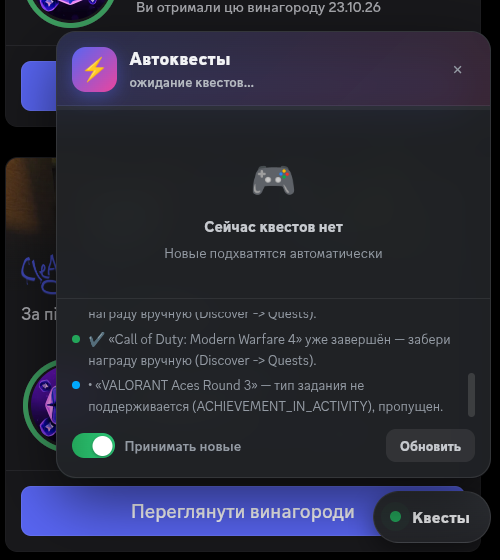

# ⚡ Discord Quest Auto-Runner

**Auto-completes Discord quests** — video quests, "play a game for 15 minutes", "stream for 15 minutes", activity quests — without installing any game. Comes with a floating glass-morphism panel that appears on the Quests tab.



> ⚠️ **Disclaimer:** automation violates the [Discord Terms of Service](https://discord.com/terms). Use at your own risk, for educational purposes.

## What it does

| Quest type | Works? | How |
|---|---|---|
| Watch video (`WATCH_VIDEO`, `..._ON_MOBILE`) | ✅ | fast-forwards timestamps via `/video-progress` |
| Play a game N minutes (`PLAY_ON_DESKTOP`, `_V2`) | ✅ | periodic `heartbeat` with a `stream_key` |
| Stream N minutes (`STREAM_ON_DESKTOP`) | ✅ | same heartbeat (+ store patch on desktop) |
| Be in an activity N minutes (`PLAY_ACTIVITY`) | ✅ | same heartbeat |
| Unlock an achievement in a game (`ACHIEVEMENT_IN_ACTIVITY`) | ❌ | server rejects it (403) — only manually |

- Quests run **in parallel** and in the background — a 15-minute quest really takes ~15 minutes (the server credits real wall-clock time between heartbeats), but all quests of this kind run at the same time.
- New quests appearing on your account are **picked up automatically** every 20 s.
- Rewards are claimed by pressing the button on the quest card (auto-claim is off by default).

## Quick start (manual, works everywhere)

1. Open **Discord** (desktop app or browser), go to **Discover → Quests**
2. Press **Ctrl+Shift+I** → **Console** tab
3. If pasting is blocked, type `allow pasting` and press Enter
4. Paste the whole script and press Enter:
   - [`quests-en.js`](quests-en.js) — English
   - [`quests-ru.js`](quests-ru.js) — русский

That's it. Stop with `__questsStop()`, status with `__questsStatus()`.

## Auto-install

### Linux (Arch-based, e.g. Omarchy) — one command

```bash
curl -fsSL https://raw.githubusercontent.com/doctorsalamii/discord-quest-auto-runner/main/install-linux.sh | bash
```

What it does:
- installs the Discord desktop client (`pacman -S discord`) if missing
- enables DevTools in `~/.config/discord/settings.json`
- installs a **supervisor** (systemd user service) that injects the script into every running Discord automatically
- patches the `Discord.desktop` entry so the client starts with a debug port

After that: just open Discord normally. Quests complete themselves. Rewards are claimed by hand on the quest cards.

> ⏳ **Be patient after opening Discord:** the panel appears within **1–2 minutes**. The supervisor scans every 30 s, and if Discord restarted itself without the debug port, it first waits out a 2-minute cooldown before relaunching it. Everything self-heals — see [Self-healing notes](#self-healing-notes).

Manual alternative:

```bash
git clone https://github.com/doctorsalamii/discord-quest-auto-runner.git
cd YOUR_REPO
./install-linux.sh
```

### Windows

1. Install Discord normally ([discord.com/download](https://discord.com/download))
2. Enable DevTools: press `Win+R`, paste `%APPDATA%\discord\settings.json`, open with Notepad, add:
   ```json
   {
     "DANGEROUS_ENABLE_DEVTOOLS_ONLY_ENABLE_IF_YOU_KNOW_WHAT_YOURE_DOING": true
   }
   ```
   (merge with the existing file if it exists), then restart Discord
3. Open Discord → `Ctrl+Shift+I` → Console → `allow pasting` → paste [`quests-en.js`](quests-en.js) → Enter

Optional (full auto-start on Windows): see [`install-windows.md`](install-windows.md) for a Task Scheduler + supervisor setup mirroring the Linux one.

## How the automatic mode works (Linux)

- `~/.local/bin/discord-quests` — launcher that starts the client with `--remote-debugging-port=9222`
- `~/.local/share/discord-quests/` — `quests.js` (the script) + `inject.mjs` (supervisor)
- `~/.config/systemd/user/discord-quests.service` — runs the supervisor at login; every 30 s it checks the running client and injects the script if it is not there. Survives page reloads and client restarts.
- Logs: `~/.local/share/discord-quests/supervisor.log`

Disable it any time:

```bash
systemctl --user disable --now discord-quests.service
```

## Panel controls

- The chip appears **only on the Quests tab** (bottom-right corner); the panel unfolds automatically
- Cards show live progress with time left; the badge on the chip = number of running quests
- Toggle **"Accept new ones"** = auto-enroll on/off
- **Refresh** forces an immediate re-scan; drag the header to move the panel (double-click to reset position)
- Green card "✔ done!" appears for 20 s when a quest completes

## Troubleshooting

| Problem | Fix |
|---|---|
| "Modules not found" | Reload the page (F5), wait 5 s, paste again |
| "no DM/voice channel found" | Open any DM once, then rerun the script |
| Heartbeat 401/403 on some quest | That quest type is desktop-only or manual — the script tells you which |
| Reward not auto-claimed | Claim it on the quest card — one click |
| DevTools don't open (desktop) | Check the settings.json key, restart Discord **after** editing |
| **Discord crashes on every launch with SIGTRAP** (Omarchy shows a crash notification) | If it happens only when launched from the menu: the menu may be opening the **package's own** `discord.desktop` (which starts Discord under uwsm/systemd-run — on some setups every Electron child process then dies with `FD ownership violation`). This installer writes its own entry as **both** `Discord.desktop` and `discord.desktop`, so the menu always opens the wrapper. Check with: `cat ~/.local/share/applications/discord.desktop` — it should point to `~/.local/bin/discord-quests` |
| **Panel / script is missing right after opening Discord** | **Just wait 1–2 minutes.** On startup the supervisor waits for its next scan cycle, and if the client restarted *itself* (its own "Restart", self-update), the supervisor first waits out a 2-minute cooldown and only then relaunches it with the debug port. It self-heals — see the supervisor log if you are impatient: `~/.local/share/discord-quests/supervisor.log` |

## Self-healing notes

The Linux supervisor runs every 30 s and handles all of these on its own, no action needed:

- Discord opened **without** the debug port (own restart / self-update) → detected and relaunched with the port (cooldown: once per 2 minutes)
- page navigated / reloaded → script re-injected
- client updated to a new build → still works (method-based module lookup, not minified names)

To disable the auto-relaunch behavior: `touch ~/.local/share/discord-quests/NO_RELAUNCH`

## Files

- `quests-en.js` / `quests-ru.js` — the script (paste into Discord console)
- `install-linux.sh` — one-shot Linux installer
- `install-windows.md` — Windows auto-start guide
- `docs-panel.png` — panel screenshot

## License

MIT — use, modify, share.

## Credits

- **Code**: written by **GLM** — an AI assistant (ZCode, model by Z.ai) — at the request of, and iterated with, the repo owner. Commits authored by it appear in the history as `GLM (ZCode AI)`.
- **Idea, testing on real hardware, setup & publication**: [@doctorsalamii](https://github.com/doctorsalamii).
